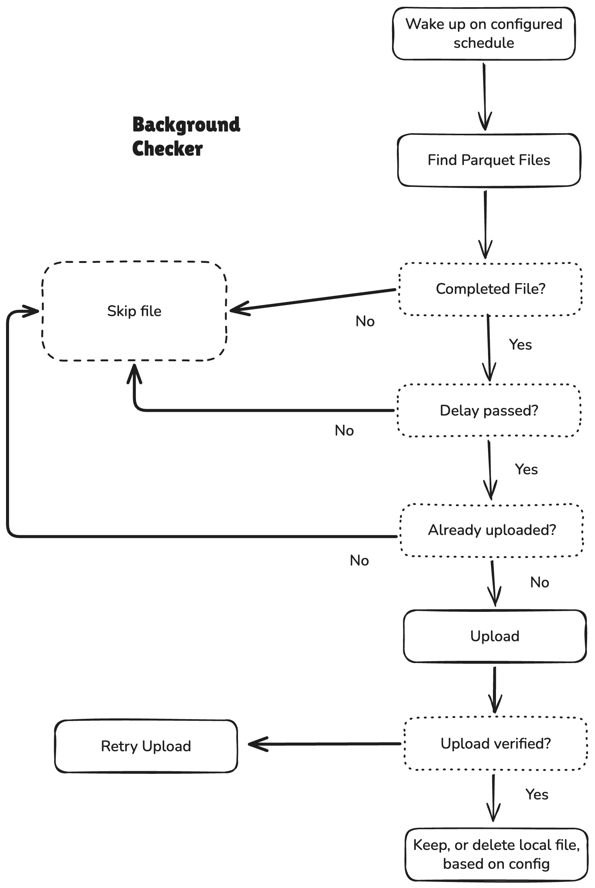

# Cloud Archiving

## Problem

Tidepool continuously collects and creates Parquet files of order book data. These files accumulate on local disk without automatic cloud archiving or any sort of cleanup.

## Goal

Automatically upload Parquet files after a set delay to a set cloud destination.

## How it Works

* Background worker checks for files that match the delay
* Upload them to cloud storage
* Verify it is there
* Record success
* Cleanup local copy if configured

## Configuration

Settings users can change:
* Cloud Provider and Bucket/Container
* Delay before uploading
* Frequency to check
* Keeping local copy after uploading
* How many times to retry upload

## Reliability

* Skip unfinished files
* Retry uploads on fails
* Only delete local copy after verify upload
* Upload runs independently of collection
* Before uploading check whether indentical file is already uploaded to cloud storage

## Testing and Success Criteria

* Confirm old files upload
* Files that are'nt old enough don't get uploaded failed
* Failed uploads get retried
* Failed uploads don't delete locally

## Decisions that need to be made

* Cloud Provider
* Delay
* Local retention policy
* What happends after retry limit is met