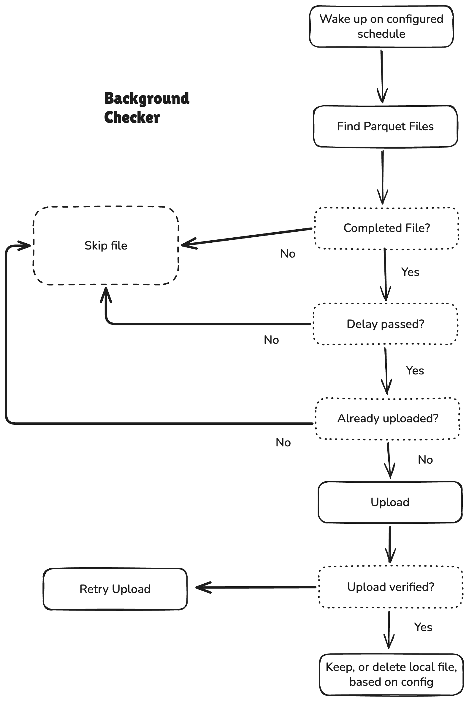

# Cloud Archiving

## Problem

Tidepool continuously collects and creates Parquet files of order book data. These files accumulate on local disk without automatic cloud archiving or any sort of cleanup.

## Goal

Automatically upload Parquet files after a set delay to a set cloud destination.

## How it Works

* Run the worker as a separate process, sharing the collector's persistent data directory
* Background worker checks for files that match the delay
* Upload them to cloud storage
* Verify it is there
* Record success
* Cleanup local copy if configured

## Configuration

Settings users can change:
* Cloud Provider and Bucket/Container
* Delay before uploading
* Frequency to check
* Keeping local copy after uploading
* Delay before local deletion (one day after verification)
* How many times to retry upload

## Reliability

* Skip unfinished files
* Retry uploads on fails
* Only delete local copy after verify upload
* Upload runs independently of collection
* Before uploading check whether indentical file is already uploaded to cloud storage
* Keep upload state in `data/archive_state.sqlite` on a persistent volume
* Track file path, cloud destination, checksum, status, attempts, and confirmation time
* Record success in SQLite only after verifying the cloud copy
* Use a consistent cloud path and compare local and cloud file sizes and checksums
* Matching files are skipped; missing files are uploaded
* If contents differ, keep the local file and report a conflict
* Use the provider's checksum validation and check cloud storage again after restarts

## Testing and Success Criteria

* Confirm old files upload
* Files that are'nt old enough don't get uploaded failed
* Failed uploads get retried
* Failed uploads don't delete locally

## Decisions and open questions

* Cloud Provider: stub out the provider integration for now
* Delay: configurable; value still to be decided
* Local retention policy: wait one day after verification before deleting the local copy
* After retry limit: mark the file as failed in SQLite, log the error, and skip it in future scans
* How to handle discrepancy between local and cloud copy during upload verification:
  * Save the original checksum in SQLite when writing finishes; keep it unchanged
  * If the local file matches its original checksum, retry the upload and verify again
  * If retries run out, keep the local file, mark failed, log the error, and move on
  * If the local checksum changed or the original checksum is missing, stop and flag for review